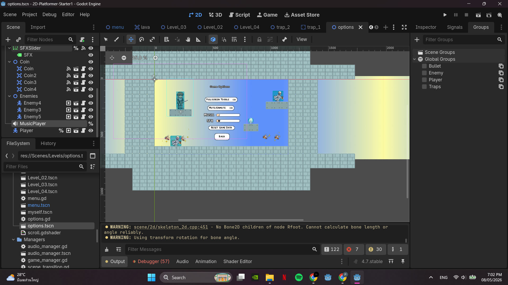
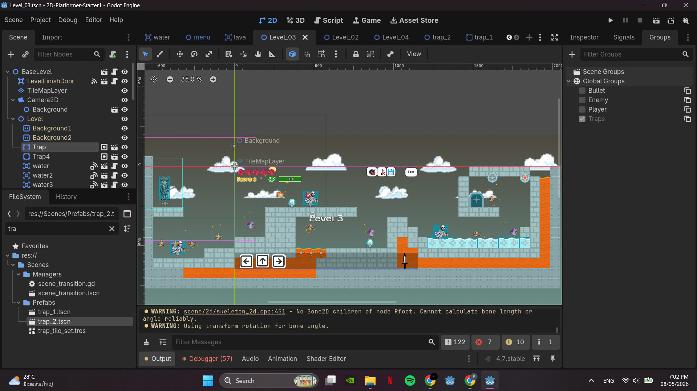

# 🐶💖🐱 Pets Game Hub

รวมมินิเกมที่ทำด้วย **Godot Engine** สำหรับวิชา Workshop 3 (GameDev 2026) เล่นได้บนเว็บเบราว์เซอร์ทันที ไม่ต้องติดตั้ง

▶ **เล่นได้ที่:** https://phonnatcha-kku.github.io/gamedev2026-project/

---

## 🎮 รายชื่อเกม

| | เกม | แนวเกม | เล่นเลย |
|---|---|---|---|
| 🐷 | **Game 21 – Piggy Leaving Farm** | 2D Arcade | [▶ Play](https://phonnatcha-kku.github.io/gamedev2026-project/Game21/Game21.html) |
| 👦🏻 | **Game 22 – Save The Boy's Farm** | 2D Survival | [▶ Play](https://phonnatcha-kku.github.io/gamedev2026-project/Game22/Game22.html) |
| ⚔️ | **Game 4 – A Long Journey** | 2D Platformer | [▶ Play](https://phonnatcha-kku.github.io/gamedev2026-project/docs/index.html) |
| 🐼 | **Game 5 – Find Your Home** | 3D Platformer | [▶ Play](https://phonnatcha-kku.github.io/gamedev2026-project/Game51/index.html) |
| 🩷 | **Game 6 – Build My Character** | 3D Character Showcase | [▶ Play](https://phonnatcha-kku.github.io/gamedev2026-project/Game61/export_web/index.html) |

---

### 🐷 Game 21 – Piggy Leaving Farm
เกมอาร์เคดแบบ 2D ใช้ลูกบอลเด้งกระทบกำแพงเพื่อช่วยให้น้องหมูหนีออกจากฟาร์ม

📁 `Game21/`

### 👦🏻 Game 22 – Save The Boy's Farm
เกมเอาตัวรอดแบบ 2D บังคับตัวละครหลบมอนสเตอร์ที่บุกเข้ามาในฟาร์ม ยิ่งรอดได้นานคะแนนยิ่งสูง

📁 `Game22/`

### ⚔️ Game 4 – A Long Journey
เกม 2D Platformer สไตล์พิกเซลอาร์ต เล่นเป็นอัศวินที่ต้องเดินทางผ่านหลายด่าน มีศัตรูโครงกระดูก กับดัก และลาวา เก็บคะแนนไว้ ระวังหลอด HP และพาตัวละครไปถึงประตูท้ายด่านให้ได้
มีเมนู Start / Continue / Option / Credit และปุ่มบังคับบนจอสำหรับมือถือ

📁 `docs/`

 

### 🐼 Game 5 – Find Your Home
เกม 3D Platformer กระโดดข้ามแพลตฟอร์มผ่านป่า เก็บเหรียญ หลบกับดัก แล้วหาประตูไปด่านถัดไปเพื่อกลับบ้าน (มี 2 ด่าน)

| ปุ่ม | การกระทำ |
|---|---|
| `W A S D` | เดิน |
| `Space` | กระโดด (กด 2 ครั้ง = Double Jump) |
| `Shift` | วิ่ง |
| `Z` | โบกมือ |
| เมาส์ | หมุนกล้อง |
| `Esc` | ปลดล็อกเมาส์ |

📁 `Game51/` (มีซอร์สโปรเจกต์ Godot อยู่ในโฟลเดอร์นี้ด้วย)

### 🩷 Game 6 – Build My Character
โชว์เคสตัวละคร 3D พร้อมแอนิเมชันหลายแบบ เช่น ว่ายน้ำ เตะบอล และโดนตี ใช้แอนิเมชันจาก [Godot4-OpenAnimationLibraries](Game61/Godot4-OpenAnimationLibraries-main/Godot4-OpenAnimationLibraries-main/README.md)

📁 `Game61/`

---

## 🛠️ เครื่องมือที่ใช้
- [Godot Engine 4](https://godotengine.org/) — ตัวเกมทั้งหมด (Export เป็น Web)
- Blender — โมเดล 3D
- GitHub Pages — โฮสต์เว็บ

## 💖 ผู้สร้าง
Website & Games created by **Phonnatcha-kku**
